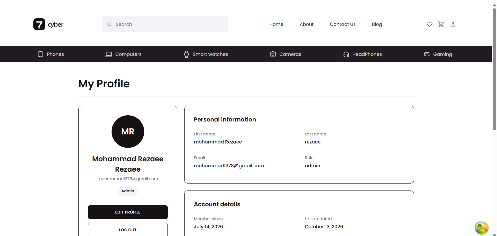
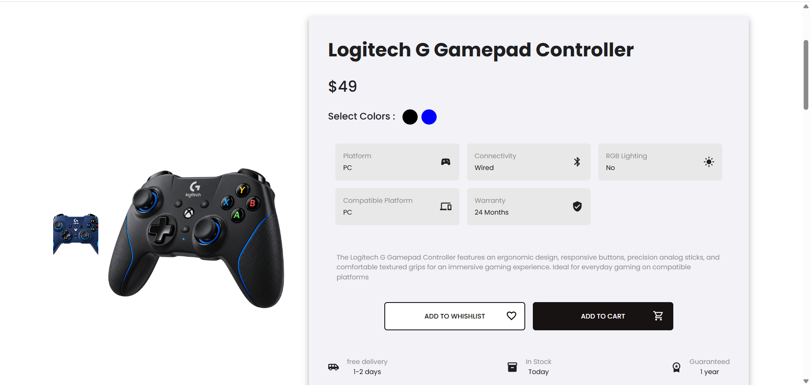
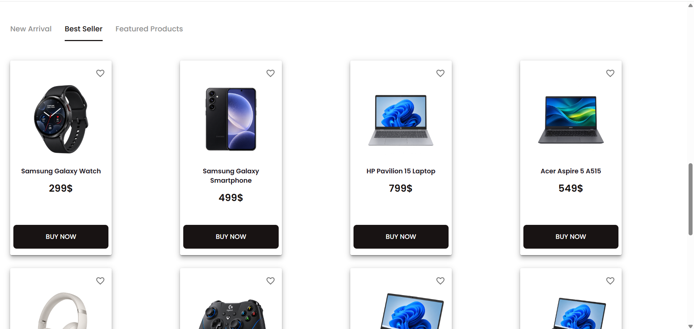
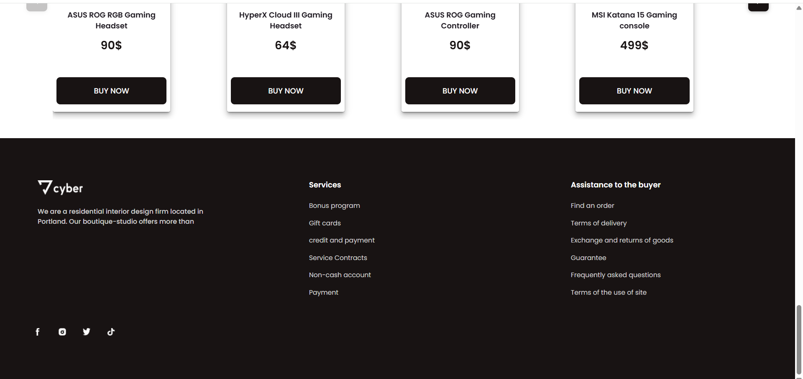
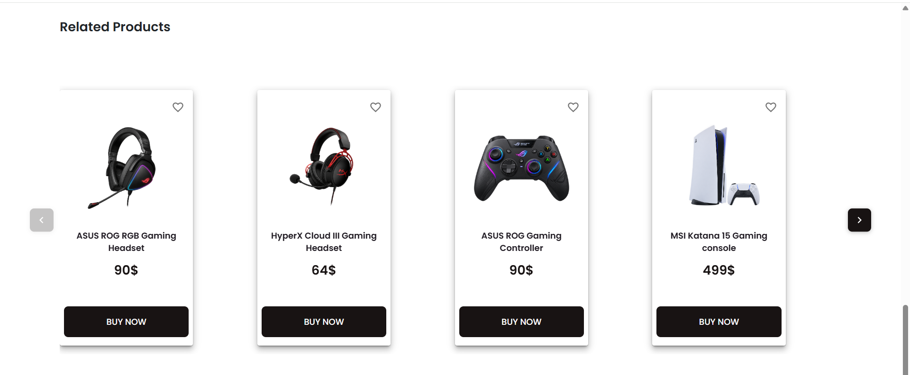
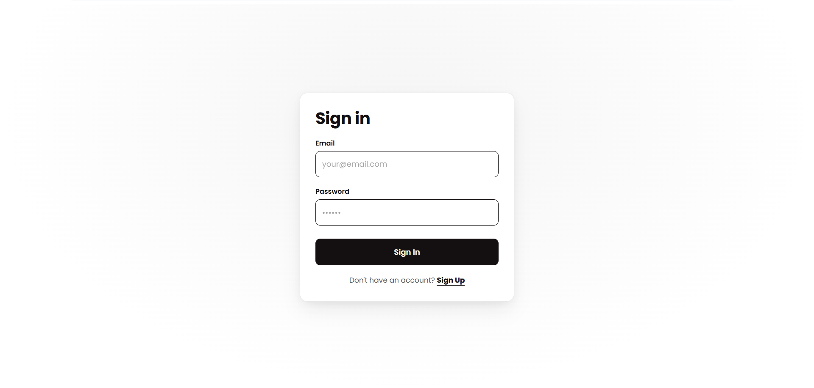

# 🛍️ Cyber_Ecommerce

### A Modern E-Commerce Experience Built with React & TypeScript

Cyber_Ecommerce is a full-stack e-commerce portfolio project featuring a customer-facing storefront and an administrative dashboard. It demonstrates my approach to building component-based user interfaces, managing application state, integrating REST APIs, and organizing a growing React application.

🌐 **Live Demo:** [cyber-ecommerce-frontend.vercel.app](https://cyber-ecommerce-frontend.vercel.app)

---

## ✨ Features

### 🛒 Customer Experience
- 🏠 Browse the product storefront and catalog
- 🔍 Search for products
- 🎯 Filter products by category and available criteria
- 📱 Explore product details, images, colors, and attributes
- 🛍️ Add products to the shopping cart and manage cart items
- ❤️ Add products to a wishlist
- 👤 Register, sign in, and access profile-related features
- ⭐ View and submit product reviews
- 📄 Navigate through dedicated informational pages

### ⚙️ Admin Dashboard
- 📦 Create, view, update, and manage products
- 🗂️ Manage product categories and category attributes
- 🏷️ Manage brands
- 🖼️ Manage promotional banners
- 👥 View and manage users
- ⭐ Manage product reviews
- 📊 Access dedicated administration pages

---

## 📸 Screenshots

Here are some screenshots showcasing the storefront and admin pages.

### 🏠 Storefront


### 🛍️ Admin Product Category


### 🖼️ Admin Banner


### 💬 Admin Review


### 👥 Admin Users


### 👥 Admin Users


### 👤 Profile




### 🛍️ Product Page




### 📱 Product Cards




### ⬇️ Footer




### 🛍️ Related Products




### ✅ Sign in




### ‼️ Not Found


---
### 🎨 UI & User Interface
- 🧩 Reusable React components
- 🎨 Material UI components and custom theming
- 🔤 Poppins typography
- 📐 Structured layouts for storefront and admin pages
- 🖼️ Product imagery and promotional visual assets
- ⚡ Client-side navigation and data-driven interfaces

---

## 🧰 Tech Stack

| Technology | Purpose |
|---|---|
| ⚛️ React | Component-based UI development |
| 📘 TypeScript | Type-safe application development |
| ⚡ Vite | Development server and production builds |
| 🎨 Material UI (MUI) | UI components and theming |
| 🧠 Redux Toolkit | Global application state |
| 🔄 TanStack Query | Server-state fetching and caching |
| 🌐 Axios | HTTP requests to the backend API |
| 🧭 React Router | Client-side routing |
| 📝 React Hook Form | Form management |
| ✅ Zod | Schema validation |
| 🧱 Bootstrap | Layout and UI utilities |
| 🎞️ Swiper | Interactive sliders and carousels |
| 🛠️ ESLint | Code-quality checks |

---

## 🏗️ Project Structure

The frontend follows a feature-oriented structure to keep related functionality organized.

```text
myApp/
├── public/             # Public static assets
├── src/
│   ├── apis/           # API clients and request modules
│   ├── Components/     # Shared application components
│   ├── constants/     # Shared constants and configuration
│   ├── features/
│   │   ├── auth/       # Authentication
│   │   ├── banner/     # Banner management
│   │   ├── cart/       # Shopping cart
│   │   ├── category/   # Category management
│   │   ├── header/     # Header and navigation features
│   │   ├── products/   # Catalog, products, reviews and admin
│   │   └── whisllist/  # Wishlist functionality
│   ├── hooks/          # Shared custom hooks
│   ├── redux/          # Redux store and slices
│   ├── routes/         # User and admin routes
│   ├── index.css       # Global styles
│   └── main.tsx        # Application entry point
├── package.json
└── vite.config.ts
```

---

## 🚀 Getting Started

### Prerequisites

Make sure you have installed:

- [Node.js](https://nodejs.org/)
- npm (included with Node.js)
- Access to the configured backend API

### 1. Clone the Repository

```bash
git clone <YOUR_PUBLIC_GITHUB_REPOSITORY_URL>
```

### 2. Open the Frontend Directory

```bash
cd <YOUR_REPOSITORY_FOLDER>/myApp
```

### 3. Install Dependencies

```bash
npm install
```

### 4. Start the Development Server

```bash
npm run dev
```

Open the local URL displayed in your terminal.

### 🏗️ Production Build

```bash
npm run build
```

### 🔎 Run Lint Checks

```bash
npm run lint
```

---

## 🔌 API Integration

The frontend communicates with a separately hosted backend API using Axios.

- API requests are organized into dedicated modules.
- TanStack Query handles server-state fetching, caching, and query updates.
- Redux Toolkit manages shared client-side application state.
- Product and banner images are resolved through frontend API utility functions.

**Note:** The backend source code is intentionally excluded from this public portfolio repository. Running the frontend locally requires the configured API service to be available.

---

## 🧠 Engineering Focus

This project demonstrates practical experience with:

- Building reusable and maintainable React components
- Structuring a multi-feature TypeScript application
- Separating API logic from UI components
- Managing server state and shared client state
- Implementing client-side navigation
- Creating forms and validating user input
- Integrating a frontend with a REST API
- Building storefront and administration interfaces

---

## 📌 Project Notes

- This repository showcases the frontend implementation of a portfolio project.
- Backend source code, environment files, and private deployment configuration are not included.
- Some features depend on the availability and configuration of the hosted backend API.
- The live demo may not expose every feature or administrative action.

---

## 👨‍💻 About

Cyber_Ecommerce is part of my frontend development portfolio, showcasing my work with React, TypeScript, modern UI libraries, state management, and API integration.

⭐ **Thanks for checking out the project!**
